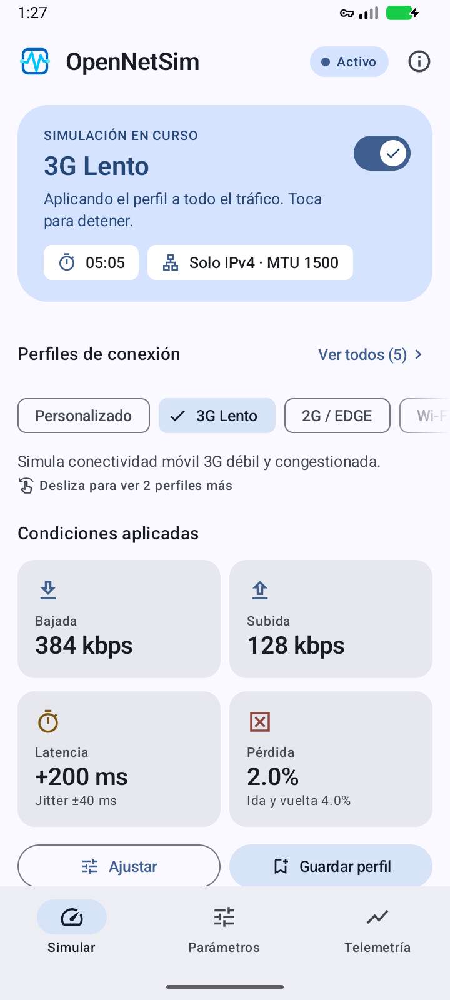
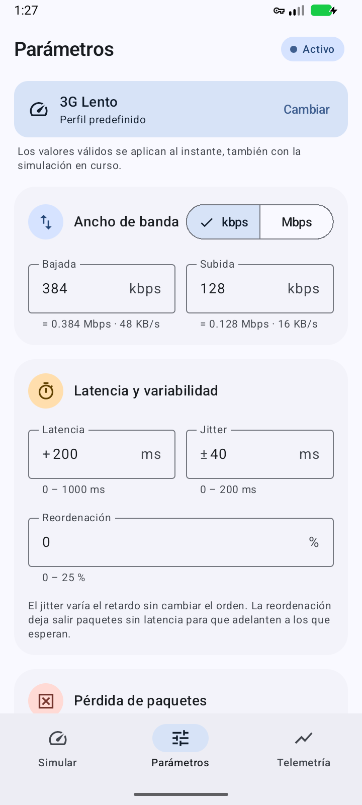
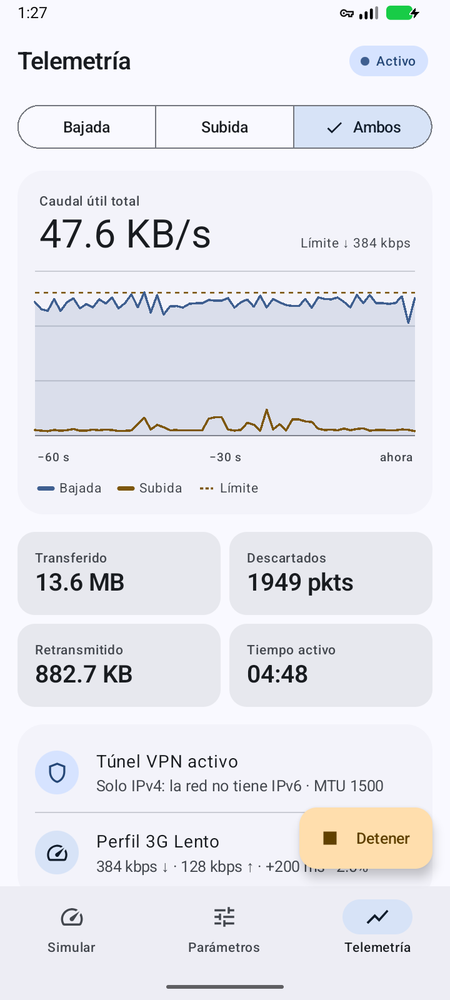
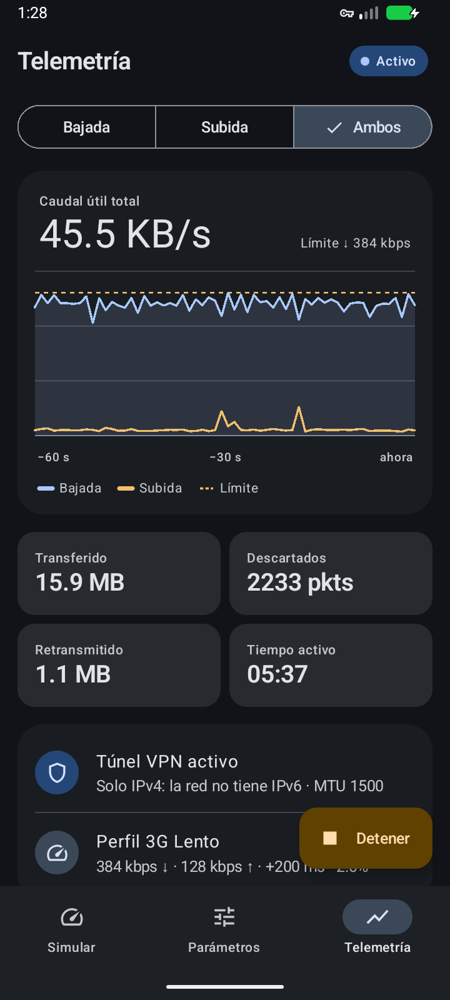
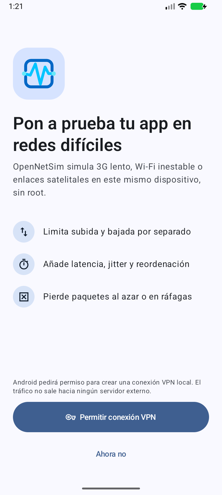
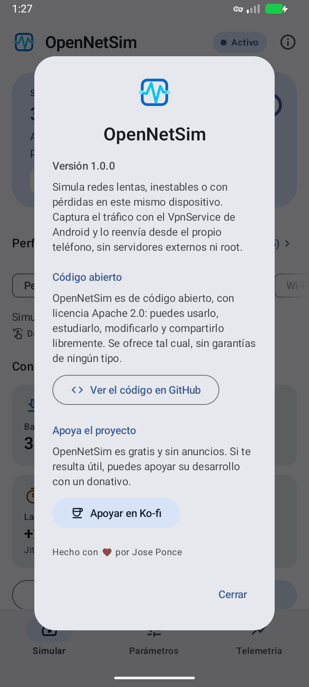
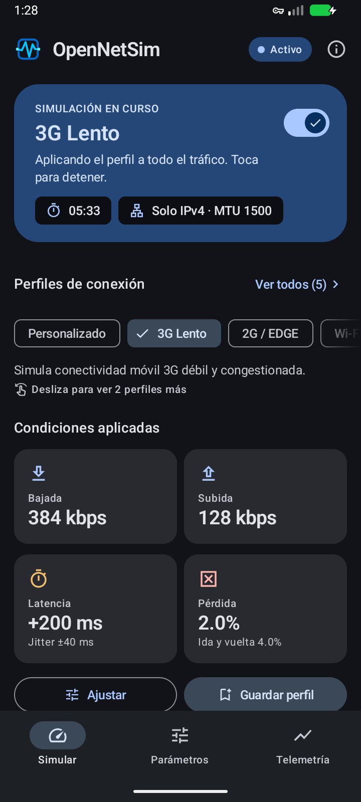
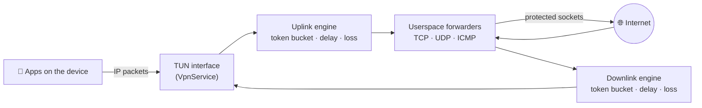

<p align="center">
  
</p>

<h1 align="center">OpenNetSim</h1>

<p align="center">
  <b>Simulate slow, flaky and lossy networks on your own Android phone.</b><br>
  No root, no external servers: everything runs on the device through Android's <code>VpnService</code>.
</p>

<p align="center">
  <a href="https://github.com/jose-ponce-1/OpenNetSim/releases/latest"></a>
  <a href="https://github.com/jose-ponce-1/OpenNetSim/actions/workflows/ci.yml"></a>
  
  
  <a href="LICENSE.txt"></a>
  <a href="https://ko-fi.com/joseponce"></a>
</p>

<p align="center">
  <a href="https://github.com/jose-ponce-1/OpenNetSim/releases/latest"><b>⬇️ Download the latest APK</b></a>
</p>

<p align="center">
  
  
  
  
</p>

---

## 🎯 What is it for?

OpenNetSim gives developers, QA engineers and network enthusiasts a lightweight on-device tool to see how
mobile apps behave on hostile connections: slow 3G, EDGE, flaky Wi-Fi, satellite-like latency or packet
loss. Turn it on, pick a profile and every other app on the phone goes through the simulated network.

> [!NOTE]
> The app is available in **English and Spanish**. It follows the device language, and on Android 13+ you
> can pick a language just for OpenNetSim in the system settings (*Settings › Apps › OpenNetSim › Language*).

## ✨ Features

- **Non-root (`VpnService`):** intercepts traffic transparently with Android's official `VpnService` API and a
  userspace TUN interface.
- **Asymmetric bandwidth:** independent upload and download limits (20 kbps – 50 Mbps) with the
  **Token Bucket** algorithm.
- **Latency, jitter and reordering:** extra round-trip delay and smooth jitter that never reorders packets,
  plus an optional reordering percentage (like `netem reorder`).
- **Packet loss:** separate upload and download rates, independent or in bursts (Gilbert model).
- **Real `ping`:** ICMP echo is forwarded to the real network with unprivileged ping sockets, so its RTT is
  the real one plus the configured degradation, and unreachable hosts do not answer.
- **Userspace L3/L4 stack in pure Kotlin:** TCP (with flow control and retransmissions), UDP (DNS,
  streaming) and ICMP forwarders, **IPv4 and IPv6 dual-stack** (IPv6 only when the physical network has it).
- **English and Spanish**, following the device language or the per-app language setting (Android 13+).
- **Material 3 UI**, light and dark, with three sections:
  - **Simulate:** one-tap tunnel switch with active time, built-in profiles and your own **saved profiles**
    (save, delete, undo).
  - **Parameters:** exact values typed in text fields (bandwidth in kbps or Mbps). Invalid values never reach
    the tunnel, and you can reset to the base profile in one tap.
  - **Telemetry:** live 60-second throughput chart against the configured limit, transferred, dropped and
    retransmitted counters, and tunnel status.

## 📸 Screenshots

| Welcome | Simulate | Parameters | Telemetry | About |
|:---:|:---:|:---:|:---:|:---:|
|  |  |  |  |  |

| Simulate (dark) | Telemetry (dark) |
|:---:|:---:|
|  |  |

The telemetry chart above was captured with the **Slow 3G** profile (*3G Lento* in Spanish) while
downloading a large file: the download stays right at the 384 kbps limit.

## 📥 Installation

1. Download `OpenNetSim-<version>.apk` from the [latest release](https://github.com/jose-ponce-1/OpenNetSim/releases/latest).
2. Open it on your phone and allow installing apps from that source when Android asks.
3. On first launch, grant the VPN permission. The tunnel only starts when you turn the simulation on.

**Requirements:** Android 8.0 (API 26) or later.

<details>
<summary>Verify the APK signature</summary>

Release APKs are signed with APK Signature Scheme v2 and an RSA 4096 certificate. Check it with
`apksigner` from the Android SDK build tools:

```bash
apksigner verify --print-certs OpenNetSim-1.0.0.apk
```

The certificate SHA-256 digest must be
`5234b875b3fb5c6d887887b1447a7509df8979b9a5d1fc8772a2fe4ea26069aa`. Each release also lists the SHA-256 of
its APK.
</details>

## 🎛️ Built-in profiles

| Profile | Download | Upload | Extra latency | Jitter | Loss (each way) |
|---|---:|---:|---:|---:|---:|
| Slow 3G (*3G Lento*) | 384 kbps | 128 kbps | +200 ms | ±40 ms | 2 % |
| 2G / EDGE | 128 kbps | 48 kbps | +400 ms | ±80 ms | 5 % |
| Flaky Wi-Fi (*Wi-Fi Inestable*) | 5 Mbps | 2 Mbps | +120 ms | ±60 ms | 8 % |
| High Latency (*Alta Latencia*: satellite / remote servers) | 10 Mbps | 2 Mbps | +600 ms | ±20 ms | 0 % |
| Custom (*Personalizado*) | your values | | | | |

Every value can be changed in **Parameters**, and any combination can be saved as your own profile.
Latency is added to the round trip and split between both directions.

## ⚙️ How it works



1. `VpnService` routes the device's traffic into a TUN interface owned by the app.
2. `TunnelPipeline` reads each IP packet and runs it through the **uplink** engine (bandwidth, latency,
   jitter, reordering and loss).
3. The forwarders terminate TCP in userspace, relay UDP and ICMP, and open real sockets that are
   *protected* from the VPN so they reach the physical network.
4. Responses go back through the **downlink** engine and are written to the TUN interface as IP packets.

The engine (`:core`) is pure Kotlin/JVM: it has no Android dependencies and is unit-tested on the JVM.

## 🏗️ Project architecture

OpenNetSim follows **Clean Architecture** principles to keep the engine decoupled, fast and testable:

```text
OpenNetSim/
├── core/                    # Gradle module :core: pure Kotlin/JVM, Android imports do not compile
│   └── com/opennetsim/
│       ├── core/
│       │   ├── engine/      # TokenBucketLimiter, LatencyQueue, JitterProcess, PacketLossSimulator
│       │   ├── packet/      # Parsers, serializers and checksums (IPv4, IPv6, TCP, UDP, ICMP)
│       │   ├── tcp/         # Userspace TCP state machine (TcpConnection, RTO, reassembly)
│       │   ├── time/        # MonotonicClock shared by the engine, forwarders and service
│       │   └── buffer/      # Contention-free ByteBufferPool
│       └── model/           # Immutable configuration, presets and telemetry models
├── app/                     # Gradle module :app: Android application
│   └── com/opennetsim/
│       ├── tunnel/          # TunnelController and ConfigStore: the only contract the UI sees
│       ├── profiles/        # User-saved connection profiles and their persistence
│       ├── service/         # VpnService lifecycle, notifications, intents and config persistence
│       │   ├── pipeline/    # TunnelPipeline: TUN loops + engine + forwarders (JVM-testable)
│       │   └── forwarder/   # Userspace TCP/UDP forwarders and real ICMP (ping) forwarder
│       └── ui/              # ViewModel and JVM-tested UI logic (fields, profiles, chart, links)
│           ├── screens/     # Compose screens: welcome, simulate, parameters, telemetry, about
│           ├── components/  # Shared Compose components
│           └── theme/       # Official palette (light/dark) and typography
├── benchmark/               # JMH microbenchmarks of the per-packet path
└── openspec/                # Specifications and archived changes (OpenSpec workflow)
```

## 🛠️ Requirements & build

- **Android SDK:** min SDK 26 (Android 8.0), target and compile SDK 35 (Android 15)
- **Language:** Kotlin 2.4 (built-in Kotlin of Android Gradle Plugin 9), Jetpack Compose with Material 3
- **Build system:** Gradle (Kotlin DSL) with a version catalog (`gradle/libs.versions.toml`)
- **JDK:** 17

### Verification commands

```bash
# Compile Kotlin code (pure :core module and Android :app)
./gradlew :core:compileKotlin :app:compileDebugKotlin

# Static analysis (detekt, including ktlint formatting rules) and Android lint
./gradlew detekt lintDebug

# Run unit test suites (JVM without emulator)
./gradlew :core:test :app:testDebugUnitTest

# Coverage with Kover: minimum 85% line coverage; HTML report in app/build/reports/kover/htmlCoverage
./gradlew :core:koverVerifyCoverage :app:koverVerifyCoverage :app:koverHtmlReportCoverage

# Microbenchmarks (JMH) of the per-packet path in :core; see openspec design for reference numbers
./gradlew :benchmark:smokeBenchmark       # quick check that benchmarks run
./gradlew :benchmark:allocationBenchmark  # time (ns/op) and allocations (B/op)

# Build debug APK
./gradlew assembleDebug

# Build release APK (R8 + resource shrinking; unsigned unless signing is configured)
./gradlew :app:assembleRelease
```

On Windows, use `.\gradlew.bat` instead of `./gradlew`. The same checks run in GitHub Actions on every pull
request.

### Release signing

The release keystore and its passwords never go in the repository. Add these Gradle properties to
`~/.gradle/gradle.properties` (or pass them as `ORG_GRADLE_PROJECT_<name>` environment variables in CI):

```properties
openNetSimReleaseStoreFile=/absolute/path/to/opennetsim-release.jks
openNetSimReleaseStorePassword=...
openNetSimReleaseKeyAlias=opennetsim
openNetSimReleaseKeyPassword=...
```

Without them, `assembleRelease` produces `app-release-unsigned.apk`. Keep a backup of the keystore: an
installed app can only be updated with an APK signed by the same key.

---

## ☕ Support

OpenNetSim is free, open source and ad-free. If you find it useful, you can support its development on
[Ko-fi](https://ko-fi.com/joseponce).

<a href="https://ko-fi.com/joseponce"></a>

## 📄 License

This project is licensed under the Apache License 2.0. See the [LICENSE.txt](LICENSE.txt) file for details.

OpenNetSim is provided **"as is", without warranty of any kind**, express or implied, and the authors are
not liable for any damage arising from its use (sections 7 and 8 of the license). It changes how your
device's traffic flows while the simulation is active: use it for testing, not as a security or privacy
tool.

<p align="center">Made with ❤️ by <a href="https://github.com/jose-ponce-1">Jose Ponce</a></p>
